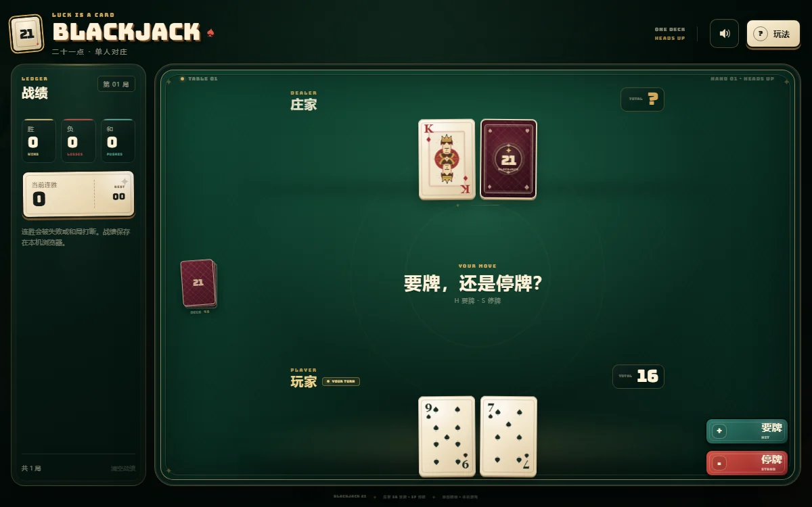

# BLACKJACK 21 · 单机 + 多人对决

一款 21 点网页游戏：**单机对庄**模式原样保留；**联机改为玩家对决**——没有系统庄家，最多 5 名玩家同牌桌各自打一手牌，终局按牌面排名分胜负。创建房间、分享 4 位房间码即可开局，经典扑克牌面与复古拼贴风格完全保留。

<p align="center">
  
</p>

## 玩法

### 联机模式（玩家对决，无庄家）

1. 首页输入昵称，点「创建联机房间」，得到 4 位房间码（如 `QHQS`）。
2. 好友打开同一地址，输入房间码「加入」，自动入座；最多 5 座，满员可观战。
3. **至少 2 名玩家**全部点「准备开局」后自动洗牌发牌，按座位顺序轮流行动（要牌 `H` / 停牌 `S`，只在轮到你时生效）。
4. 所有人行动完毕立刻结算：所有手牌排名，**最强者唯一则胜、其余皆负；最强并列或全员爆牌则平**。8 秒后自动回到大厅，再次准备即可开下一局。

对决规则细节：

- **排名规则**：天牌（两张 21）> 多张牌凑成的 21 > 普通点数 > 爆牌；爆牌不再立即判负——对手也可能爆，终局统一判定。
- **轮换暗牌**：每人的手牌中**只有最新一张是对手的暗牌**（开局第 2 张为暗牌；每次要牌翻开上一张、新摸的盖上）——对手只见你的明牌点数，多要一张牌就多亮一张。自己永远看得到自己全部手牌；终局统一翻开所有暗牌结算。
- **服务端权威**：牌堆顺序与对手暗牌只存在于服务端，客户端收到的是按观看者脱敏的视图（暗牌为固定占位符，牌堆只发剩余张数），改内存 / 抓包都无法看穿。
- **房主管理**：建房者即房主（座位卡带「房主」徽章）；房主断线时权限自动顺位给座位号最小的在线玩家，原房主回来自动收回。房主可点击其他座位上的「✕」将其移出房间（两次点击确认），大厅内座位立即释放，对局中则保留手牌打完本局并广播系统消息。
- **断线恢复**：会话保存在浏览器 localStorage——关闭标签页甚至重启浏览器后重新打开同一地址，自动回到原座位（战绩、手牌一并恢复）。换设备或清过缓存时，**输入相同昵称 + 房间码加入即可认领自己的旧座位**（房间内没有同名在线玩家时生效）。
- **离线托管**：轮到离线玩家时只等 6 秒（在线玩家 30 秒）即自动停牌，牌局不会因有人掉线而卡死；离线且未准备的玩家不阻塞开局，发牌时直接跳过。
- **房间聊天**：右下角 💬 打开聊天面板——文字消息 + 表情快捷栏，未读红点计数，新加入者自动收到最近 50 条历史；服务端限频（1.2 秒/条）防刷屏。
- **回合超时**：轮到某座 30 秒无操作自动停牌，牌局不会卡死。
- **防连点**：要牌 / 停牌 100ms 限频；携带过期局号的迟到操作直接丢弃。

> 同一浏览器的多个标签页共享身份（后加入者会顶掉前者，提示「同一玩家已在其他窗口入座」）；想双人同机测试请用无痕窗口或两台设备。

### 单机模式

与原版一致：`H` 要牌、`S` 停牌、`Enter` 开局、`?` 玩法说明；庄家 16 要牌 / 17 停牌（软 17 停），战绩保存在 localStorage。

## 快速开始

### 环境要求

- Node.js 22+
- pnpm 11+（`npm install -g pnpm`）

### 一键启动（Windows）

双击 **`start.cmd`**：自动安装依赖 → 构建前端 → 启动服务并打开浏览器，地址 `http://127.0.0.1:3000/`。

### 命令行

```bash
pnpm install

# 开发模式（服务端 tsx 热重载 + 前端 Vite 热更新，两个进程一起跑）
pnpm dev          # 前端 http://127.0.0.1:5173 （/socket.io 自动代理到 3000）

# 生产模式（单进程：页面 + WebSocket 同端口）
pnpm build        # 全仓 typecheck + 前端构建
pnpm start        # http://127.0.0.1:3000/
```

### 和朋友联机

| 场景 | 做法 |
| --- | --- |
| 同一 Wi-Fi / 局域网 | 你运行 `start.cmd`（或 `pnpm start`），朋友访问 `http://你的局域网IP:3000`（Windows 防火墙放行 Node） |
| 远程（免费） | 在你电脑上跑 `cloudflared tunnel --url http://localhost:3000`，把得到的 https 地址发给朋友（域名每次重启会变）；或用 cpolar / natapp 免费版 |
| 常驻部署 | 任意支持 WebSocket 的平台（Render / Railway / Fly.io / 自己的 VPS）：`pnpm install && pnpm build` 后 `PORT=8080 pnpm start`，平台自配 HTTPS 证书 |

> 联机模式是单进程 Node 服务（页面 + WebSocket 同端口），不需要额外的静态托管或证书。Socket.IO 在 WebSocket 被拦的网络上会自动降级为 HTTP 轮询。

## 游戏规则

**联机对决**：标准一副 52 张牌每局重洗（服务端 crypto 随机）；A 算 1 或 11 自动取优，J/Q/K 算 10。开局两张 21 为天牌，排名高于多张凑成的 21；爆牌只是「停止行动」，胜负等终局排名。当前版本不含下注、加倍、分牌和保险。

**单机对庄**（与原版一致）：庄家 16 及以下必须要牌，17 及以上停牌（含软 17）；玩家爆牌立即结束。

## 架构

pnpm monorepo，三个包：

```text
packages/
├─ game/     # @bj/game 纯函数规则引擎（无任何依赖，Node / 浏览器通用）
│  ├─ deck/hand/dealer/result/stats   # 单机规则（dealer/result 仅单机使用）
│  ├─ duel.ts                        # 对决排名：天牌>21>点数>爆牌，并列最强为平
│  ├─ reducer.ts                      # 单机状态机（离线模式，原样保留）
│  ├─ table.ts                        # 联机对决状态机：入座/准备/轮转/终局排名/幽灵座/超时
│  ├─ view.ts                         # 视图投影（手牌公开，牌堆只发剩余张数）
│  └─ timing.ts                       # 服务端与客户端共享的节奏常量
├─ server/   # @bj/server Express + Socket.IO 房间服务
│  ├─ room.ts       # 房间：apply→reducer→广播视图→按阶段重排定时器（无庄家调度）
│  ├─ manager.ts    # 房间码生成 / 查找 / 空房 GC（10 分钟无连接回收）
│  ├─ index.ts      # 入口：Socket.IO 意图协议 + 静态托管 client/dist（SPA fallback）
│  └─ integration.test.ts  # socket.io-client 双客户端集成测试
└─ client/   # @bj/client React 19 + Vite 前端
   ├─ net/useOnlineGame.ts    # socket 生命周期 / 建房 / 加入 / 断线自动重连
   ├─ components/HomeScreen / OnlineGame（对决牌桌+终局排行榜）/ OfflineGame（原单机界面）
   └─ styles/online.css       # 大厅与房间样式（复用原有设计 token）
```

### 协议（客户端 → 服务端只有意图，永不传牌）

```text
room:create {name}            → {roomId, playerId}
room:join   {roomId,name,playerId?}  → {roomId, playerId} 或 {error}
            （无 playerId 时，服务端按昵称回收同房间「离线座位」的旧身份）
room:kick   {seatIndex}       （仅房主生效；被踢者收到 room:kicked）
chat        {text}            （双向同名事件；服务端清洗+限频后广播，进房先补发 chat:history）
intent      {type: ready|unready|hit|stand|standUp, roundId?}
服务端 → 客户端：state（按观看者脱敏的 TableView 全量快照）、chat、room:kicked、room:replaced、room:closed
```

## 开发与检查

```bash
pnpm typecheck   # 三包全量类型检查
pnpm test        # game 75 个用例 + server 9 个 socket 集成用例
pnpm build       # typecheck + 前端生产构建
```

引擎测试覆盖：A 的 1/11 取值、庄家 16/17 策略（单机）、天牌/爆牌/平局、对决开局 ≥2 人、多座位轮转顺序、越权操作拒绝、爆牌不预结算、天牌并列平局、全员爆牌平局、幽灵座位参与结算、断线标记与恢复、过期局号丢弃。

## 本地数据

- 单机：`blackjack.stats.v1`（战绩）、`blackjack.settings.v1`（声音）等 localStorage。
- 联机：`bj.online.session.v1`（localStorage，断线重连凭据，关标签页/重启浏览器后仍可回到原座位）；战绩由服务端房间内存态保存，服务重启后房间清空。

## 致谢

整体视觉氛围受到桌面卡牌游戏与复古拼贴风格启发，但所有牌面、人头牌 SVG、牌背、图标、纹理和文案均为本项目原创，不含《小丑牌》（Balatro）的游戏素材，也与该作品及其发行商无关联。
